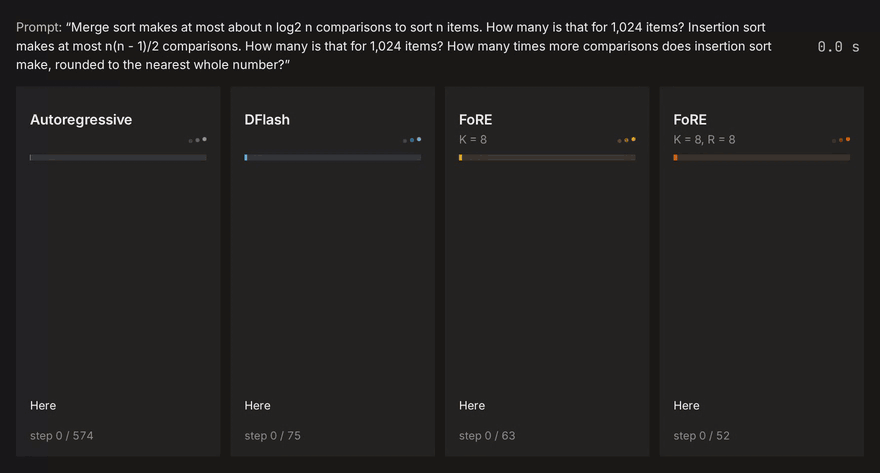

<div align="center">

# FoRE: Fork and Regenerate

**Fork and Regenerate: MTP-Guided Early Forking and Suffix Regeneration for Block Diffusion Speculative Decoding**

Bruh Lemma Yadecha, Li Yang

University of North Carolina at Charlotte

<a href="https://huggingface.co/collections/byadecha/fore-6ac86bb87b4d14bc6f429f9d"> <b>Models</b></a>



</div>

Inference and fine-tuning code for FoRE on Qwen3.5-9B and Qwen3.5-4B, with a fine-tuned DFlash
block diffusion drafter. The output is the target's greedy continuation, up to bf16 near-ties.

## How it works

Each decoding step:

1. MTP-guided early forking: the target's pretrained MTP module proposes the top-K candidates
   for the first drafted position. One batched drafter pass generates the rest of a block for
   each candidate, with the candidate supplied as the block's first draft token.
2. Draft refinement: replacement tokens at later positions are ranked by the probabilities of
   their retained prefix and the replacement, reusing the distributions from step 1. The top R
   become additional drafts, and a second drafter pass regenerates the suffix after each
   replacement.
3. The target verifies all K+R drafts as rows of one batched forward pass and commits the longest
   prefix that matches its greedy predictions, plus its own next token.

## Installation

Requires Linux, an NVIDIA GPU, CUDA 13.0 (`nvcc` on `PATH` to build `causal-conv1d`) and
[uv](https://docs.astral.sh/uv/).

```bash
uv sync --locked --extra flash-attn
```

## Quick start

Download a target and its FoRE drafter, `byadecha/Qwen3.5-9B-FoRE` or `byadecha/Qwen3.5-4B-FoRE`:

```bash
uvx --from huggingface_hub hf download Qwen/Qwen3.5-9B --local-dir models/Qwen3.5-9B
uvx --from huggingface_hub hf download byadecha/Qwen3.5-9B-FoRE --local-dir models/Qwen3.5-9B-FoRE
```

```bash
uv run fore-generate \
  --target models/Qwen3.5-9B \
  --drafter models/Qwen3.5-9B-FoRE \
  --k 8 \
  --r 8 \
  --prompt "Write a Python function that returns the n-th Fibonacci number."
```

The paper's settings are `--k 8 --r 0` and `--k 8 --r 8`.
All options, including `--attention sdpa` without the `flash-attn` extra, are in
[docs/training.md](docs/training.md#fore-generate-options).

From Python:

```python
from fore import load, generate

target, drafter, mtp, tokenizer = load("models/Qwen3.5-9B", "models/Qwen3.5-9B-FoRE")
ids, steps = generate(
    target,
    drafter,
    mtp,
    input_ids,
    max_new_tokens=512,
    stop_ids=[tokenizer.eos_token_id],
    k=8,
    r=8,
)
```

`steps` holds the tokens committed per step; its mean is the acceptance length τ.

## Training and reproduction

Training data, fine-tuning and the pinned environment are in [docs/training.md](docs/training.md).

## License

FoRE is released under the Apache License 2.0 ([LICENSE](LICENSE)). Third-party code, models
and data keep their own licenses, listed in [THIRD_PARTY.md](THIRD_PARTY.md).
